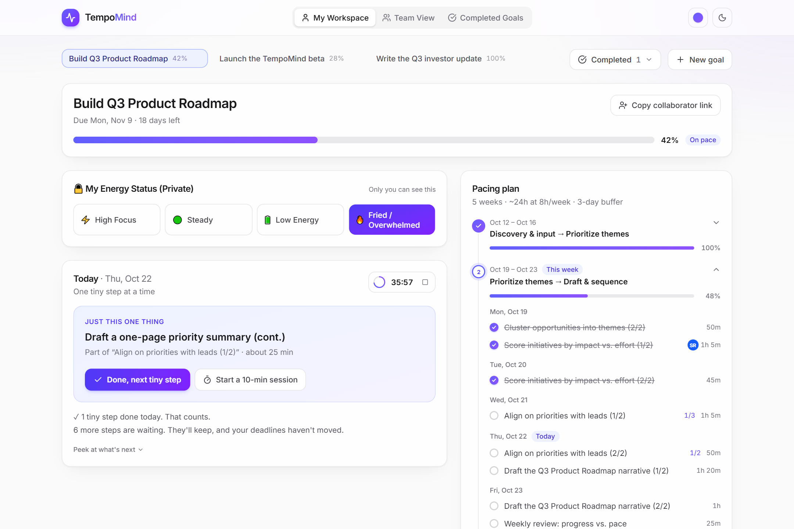
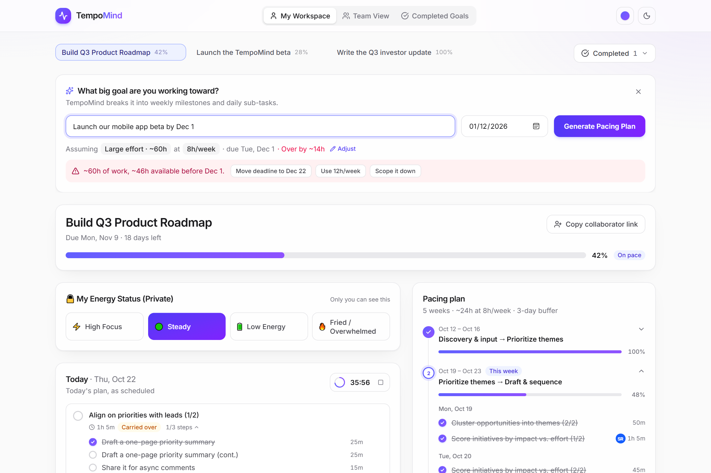
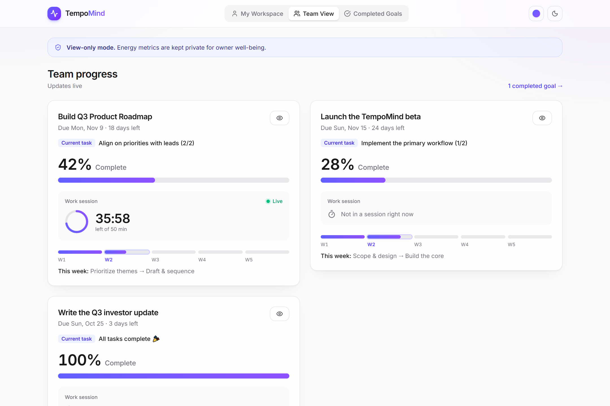

# TempoMind

**Plans that fit your energy. Progress your team can see. Feelings that stay yours.**

TempoMind breaks big goals into a realistic plan, adapts today's work to your energy, and keeps your teammates updated, without ever showing them how you're actually feeling.

Built for the **TaskForge** hackathon on Devpost.

**▶ Try it live: [nickeng11.github.io/tempomind](https://nickeng11.github.io/tempomind/)** (runs in your browser with demo data; nothing is sent anywhere)



| Planner with capacity check | Team view (no energy, pace or hours) |
|---|---|
|  |  |

## Run it

```bash
npm install
npm run dev      # http://localhost:5173
npm run build    # type-check + production build
```

## Features

- **Pacing plan:** enter a goal and deadline (dates like "by Nov 15" are detected automatically), then click **Generate Pacing Plan**. The planner classifies the goal (roadmap, product build, writing, learning or general) and produces weekly milestones, daily sub-tasks and micro-steps of 25 minutes or less.
- **Effort & capacity check:** the planner guesses how big the goal is (Small ~6h, Medium ~24h, Large ~60h) and uses your hours per week to check it fits before the deadline. If it doesn't, it suggests a later deadline, more hours, or a smaller scope. When there's slack, the last ~15% of the runway is kept as buffer.
- **🔒 Private energy slicer:** ⚡ High Focus / 🟢 Steady / 🔋 Low Energy / 🔥 Fried re-slice *today's* work (deep-work blocks, ~20-min chunks, or one tiny step at a time). Task dates, milestones and deadlines are never changed.
- **Focus sessions:** start a timed session from Today; teammates see the task name and a live countdown.
- **Team view (view-only):** current task, % complete, live session countdown and a weekly timeline. Pace and hours worked vs. planned are deliberately not shared, since day-to-day output can hint at someone's energy; the owner still sees their own pace in My Workspace.
- **Human-in-the-loop completion:** at 100% a goal shows **Mark for completion**; after confirming, it's locked and greyed out in the **Completed** menu beside your project tabs, and listed on the read-only **Completed Goals** page. Unticking it (and confirming) makes it live again.
- **Collaborator links:** **Copy collaborator link** in My Workspace gives someone access to that one goal only: its completion bar and pacing plan, where they can tick tasks off. They enter their name once (browsers can't read a computer's account name), and anything they complete shows their initials badge in the pacing plan (a consistent, accessible colour per person) with "Completed by [name]" on hover or keyboard focus. They never see the owner's energy status, today plan, pace or hours.
- **View-only links:** from the Team View page, a standalone progress page anyone can read but not change. Both kinds of link update live in other tabs of the same browser.
- **Separate, unguessable link codes:** every goal has its own random 128-bit code for each kind of link, and neither is the goal's internal id. Editing a view-only link's URL into a collaborator link finds nothing, and team pages never receive the collaborator code.
- **Colour schemes & dark mode:** five palettes, generated from Tailwind's colour scales (`npm run palettes`).

## Accessibility

- WCAG AA colour contrast (4.5:1 text, 3:1 focus indicators) in every palette, light and dark.
- Full keyboard use with visible focus rings and a skip-to-content link.
- Screen-reader labels and live announcements for planning progress, the capacity check, energy mode and copied links.
- Respects the OS "reduce motion" setting.
- Fried / Overwhelmed mode is designed for cognitive overload: one small step at a time.

## Privacy model

- Energy check-ins live in a separate owner-only store (`tempomind.owner-private.v1`) and reset daily.
- The team view, Completed Goals and share pages receive **projects only**, and render from `toPublicView()` (`src/lib/metrics.ts`), whose inputs don't include energy.
- The public "current task" is always the parent task, never an energy-sized micro-step.
- The public view carries no pace, hours planned, hours done or projected finish date, so output levels can't be read from it.

## How it was built

Built in VS Code with [Claude Code](https://claude.com/claude-code) as an AI pair programmer, using Vite, React 19, TypeScript, Tailwind CSS v4, Motion and Lucide icons. Accessibility (contrast, keyboard, screen readers, reduced motion) and privacy (energy data never reaching team pages) were checked with automated tests throughout.

## Demo notes

- The planner is a rules-based stand-in for an LLM: `generatePacingPlan()` (`src/lib/planner.ts`) streams its "thinking" like a model would. To use a real model, replace its body with an API call that returns the same `Project` shape.
- Data is stored in the browser (localStorage), so share links only work within the same browser. **Reset demo data** at the bottom of My Workspace restores four sample goals: one behind with a live focus session, one ahead, one ready to mark complete and one already completed.

## What's next

- Opt-in AI agents that scan work emails for action items, turn them into to-dos and assign them to the right person's list, so no task slips through the cracks.
- A backend with sign-in, so share links work for real teammates and energy data is protected server-side.
- A real LLM behind `generatePacingPlan()`.
- Learning from actual time spent to calibrate future estimates.

## Stack

Vite · React 19 · TypeScript · Tailwind CSS v4 · Motion · Lucide icons
